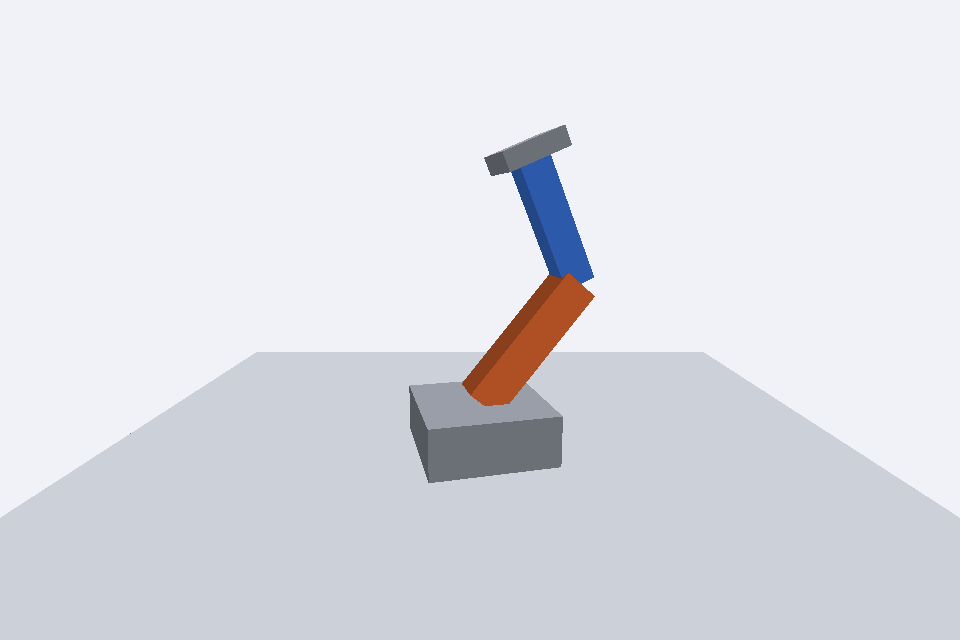

# Braço robótico

Disciplina: Computação Gráfica

Atividade: Braço robótico

Integrantes: Gabriel Possa Lima e Darlan José dos Santos

Descrição: Um pivô no topo da base sustenta o braço laranja pela extremidade inferior. Outro pivô na extremidade superior do braço sustenta o antebraço azul, que leva a garra cinza. A hierarquia transmite a rotação da base e das articulações aos segmentos descendentes.

Resposta da questão: As caixas são criadas com a origem no centro; se girassem diretamente, rodariam em torno desse centro, e não da articulação. Os pivôs `Object3D` colocam a origem da rotação no ombro e no cotovelo. Pela hierarquia do grafo de cena, girar o ombro leva também cotovelo, antebraço e garra, enquanto girar o cotovelo move apenas o antebraço e a garra.

