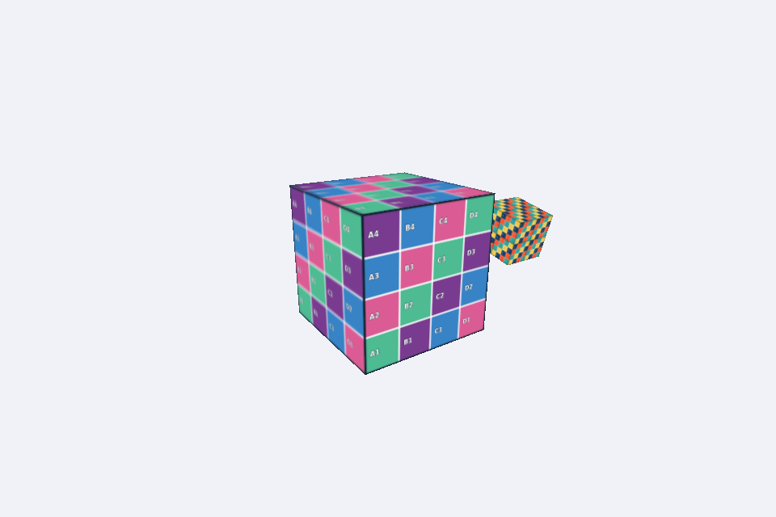

# Cubo com satélite texturizado

Disciplina: Computação Gráfica

Atividade: Cubo com satélite texturizado

Integrantes: Gabriel Possa Lima e Darlan José dos Santos

Descrição: O cubo principal usa `mosaico.png`. O satélite, filho dele, usa `grade_uv.png` com `repeatUV = [2, 2]`, fica a 1,3 unidade do centro e tem escala 0,4. Ele acompanha a rotação do cubo principal e também gira no próprio eixo X.

Resposta da questão: As coordenadas UV associam os vértices de cada face a posições da imagem: U indica a direção horizontal e V a vertical. Assim, o renderizador sabe qual parte da textura aplicar em cada ponto da superfície. Com `repeatUV = [2, 2]` e o modo de repetição da textura, a imagem aparece duas vezes em cada direção de cada face, formando uma grade de 2 × 2 cópias sem alterar a geometria.

